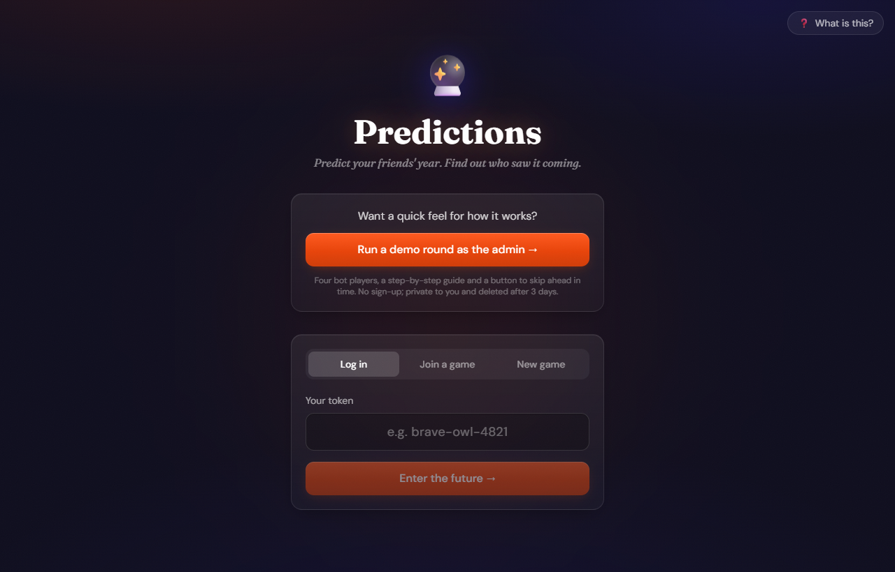
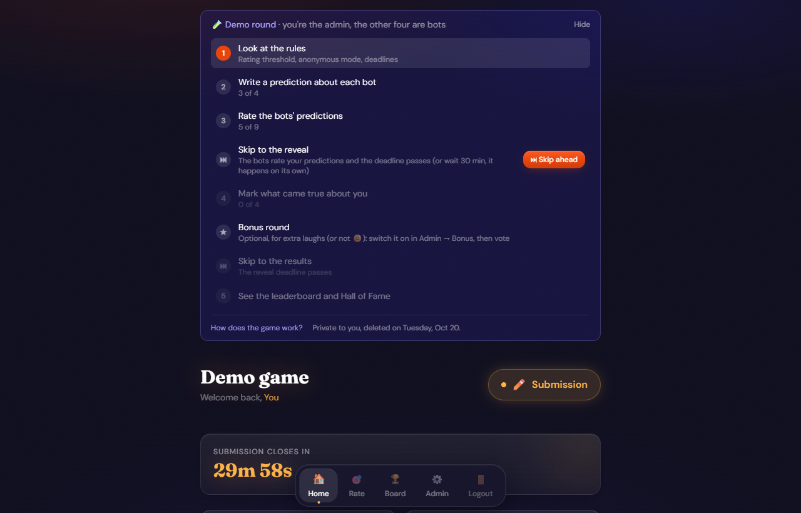
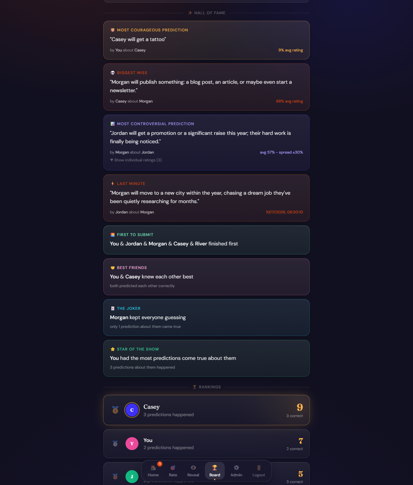
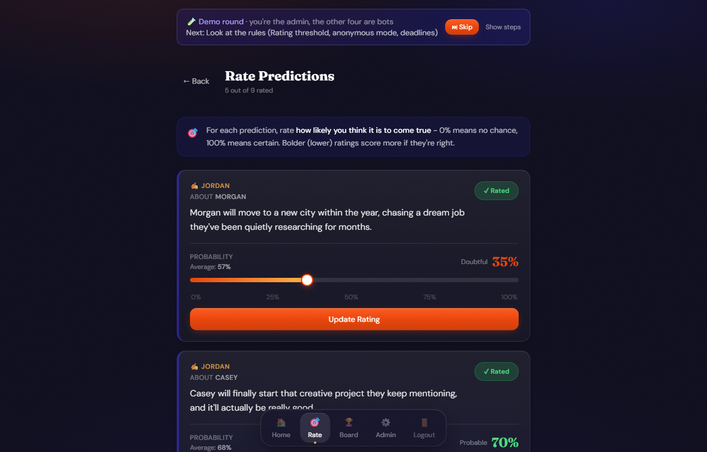
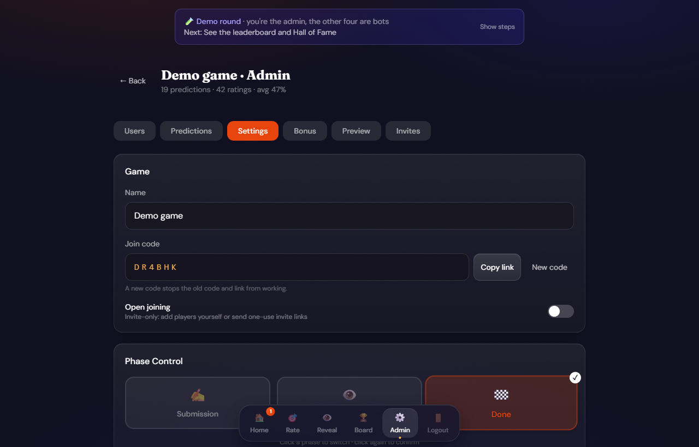
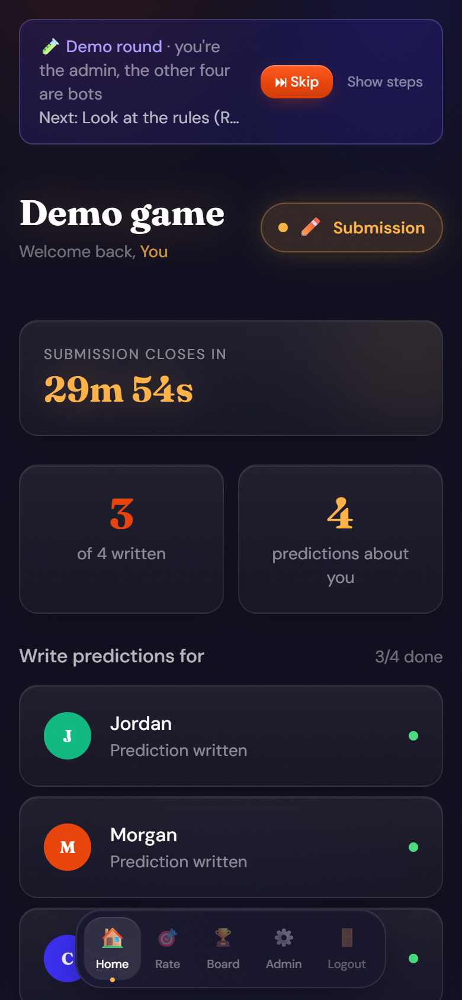
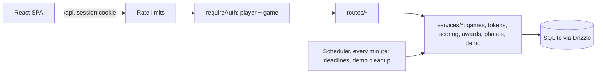

# 🔮 Predictions

**A social prediction game: predict your friends' year, rate how bold each call is, and find out
who saw it coming.**

[](https://github.com/06cezar/predictions/actions/workflows/ci.yml)

**[▶ Live demo](https://predictions-app.fly.dev)**: click **Run a demo round as the admin**. No
sign-up; you get a private game with four bot players, a step-by-step guide, and a button that
skips ahead in time.

<p align="center">
  
</p>

## What it is

Everyone in a group writes one prediction about each other player ("Will run a marathon",
"Will move to Lisbon"). The group secretly rates how likely each prediction is. When the deadline
passes, predictions are revealed, their targets mark what actually came true, and the people who
made bold calls that came true win.

I built it for my own friend group, and we played a real game on it. I then turned it into a
multi-tenant app: anyone can host their own game on the same deployment, and visitors can play a
full round alone against deterministic bots.

**Stack:** TypeScript · React 18 · Vite · Tailwind CSS · Node.js · Express · SQLite · Drizzle ORM ·
Vitest · Supertest · Docker · Fly.io · GitHub Actions

## Screenshots

| Demo round with the step-by-step guide | Hall of Fame and rankings |
|---|---|
|  |  |
| **Rating other players' predictions** | **Admin settings: join code, phases, rules** |
|  |  |

<p align="center">
  
  <br><em>Works on phones too</em>
</p>

## How a game works

| Phase | What players do |
|---|---|
| **Submission** | Write (and edit) one prediction about each other player. Rate other people's predictions about the friends you also wrote about, from 0% (no way) to 100% (certain). Predictions about you stay hidden until the reveal. |
| **Reveal** | See what everyone predicted about you and mark each one: happened, or didn't. |
| **Done** | The leaderboard and the Hall of Fame unlock. |

Phases change on their own at the deadlines (a scheduler checks every minute), or when the admin
moves them.

**Scoring.** Points go to whoever wrote a prediction that came true, and the less the group believed
it, the more it is worth. With the default 50% threshold: average rating below 12% → 5 points,
below 25% → 4, below 37% → 3, below 50% → 2, otherwise 1. Each edit costs half a point (minimum 0.5),
and the admin can forgive edits.

**Hall of Fame.** Nine awards, such as Most Courageous (came true despite the lowest rating),
Biggest Miss, Most Controversial (widest spread of ratings), Best Friends (two players whose
predictions about each other both came true) and The Joker (the player nobody could predict).

## Features

**For players**
- Write, edit and rate predictions; mark outcomes in the reveal; leaderboard and Hall of Fame at the end
- Optional bonus round: ranked-choice voting on categories like "most likely to move abroad", worth extra points
- In-app notifications (new predictions about you, outcomes, phase changes), anonymous or named predictions
- No passwords: a token like `brave-owl-4821` is your login

**For hosts (game admins)**
- Create a game in one step; invite people with a six-letter join code, a link, or one-use invite links
- Turn open joining off, issue a new code, add players and rotate their tokens
- Set deadlines, rating threshold and anonymity; phases advance automatically or by hand
- Track who has written, rated and marked outcomes; preview scores and awards before the end
- Export predictions, scores and awards as CSV, or the whole game as JSON

**For visitors: the demo round**
- One click, no sign-up: a private game where you are the admin and four bots play with you
- A step-by-step guide that ticks off as you go, plus **Skip ahead**, which fast-forwards to the next phase as if the deadline had passed
- Deterministic bots: scripted predictions, ratings of your predictions derived from your text and each bot's personality, so the same moves always give the same leaderboard
- Left alone, each phase lasts 30 minutes; demo games delete themselves after three days

## Tech stack

| Layer | Technology |
|---|---|
| Frontend | React 18, TypeScript, Vite, React Router, Tailwind CSS |
| Backend | Node.js 20, Express 4, TypeScript |
| Database | SQLite (better-sqlite3, WAL mode) with Drizzle ORM, versioned migrations |
| Sessions | express-session with a SQLite session store |
| Security | express-rate-limit, hardened cookies, input validation (details below) |
| Testing | Vitest and Supertest: 270+ tests against in-memory SQLite |
| Delivery | Multi-stage Docker image on Fly.io with a persistent volume; GitHub Actions CI (typecheck, test, build) |

## Security and reliability

**Rate limiting** (express-rate-limit, per client IP; `trust proxy` is set so Fly.io's proxy
doesn't hide the real address):

| Requests | Limit |
|---|---|
| Logging in and out (`/api/auth/*`) | 20 per 15 minutes |
| Creating a game or a demo (`POST /api/games`, `POST /api/demo`) | 10 per hour |
| Joining with a code (`POST /api/games/join/:code`) | 20 per 15 minutes |
| Anything else under `/api` | 200 per minute |

**Isolation between games.** Every request resolves the player's game once, and every lookup by id
is scoped to it, so another game's predictions, players, categories and invites answer 404, not
403 (which would confirm they exist). A suite of 21 tests puts two games in one database and has
players and admins of one try to read or change the other. Breaking a filter makes them fail.

**Logins.** Tokens are the only credential and are unique across all games. When someone asks for
a token that is already taken, the owner's token is rotated and the old one blocked, rather than
answering "already in use", which would let anyone probe for working logins
([design notes](docs/invite-links.md)). Generated tokens have about 1.3 million combinations, on
top of the login rate limit.

**Sessions.** `httpOnly`, `secure` and `SameSite=Lax` cookies; the server refuses to start in
production without `SESSION_SECRET`. Sessions live in SQLite, so restarts don't log anyone out.

**Input and errors.** Settings are validated (types, ranges, dates), names are capped at 40
characters, and malformed JSON gets a 400. Errors and unknown API routes answer JSON, never a stack
trace.

**Data safety.** Schema changes run as numbered migrations in a transaction with a foreign key
check, so a failed migration leaves the database untouched. The move from one game to many was
rehearsed on a copy of the production database before release. Admins can export only their own
game; there is no raw database download.

## Architecture



```
client/              React SPA
  pages/admin/       one component per admin tab
server/
  index.ts           entry point: migrations, scheduler, static files in production
  app.ts             Express app: sessions, rate limits, error handling, routes
  auth.ts            loads the player and their game into res.locals for every request
  routes/            thin HTTP handlers, one file per resource
  services/          game logic with no HTTP:
    games.ts           games, join codes, wiping and deleting a game
    tokens.ts          token generation and conflict-safe claiming
    snapshot.ts        a game's data, loaded with one query per table
    scoring.ts         leaderboard scoring and bonus tallies
    awards.ts          the nine Hall of Fame awards as pure functions
    phases.ts          the single place a game changes phase (and the demo's skip)
    demo.ts            demo content, deterministic bots, progress, expiry
  migrate.ts         versioned schema migrations (PRAGMA user_version)
  schema.ts          Drizzle table definitions
tests/               API tests against in-memory SQLite
scripts/             seed and reset utilities
```

- **Many games, one database.** Players, predictions, bonus categories and invite links carry a
  `game_id`; everything else hangs off those.
- **One snapshot, pure functions.** Scoring and awards load a game with one query per table and
  compute results in memory. The API and the CSV exports share these functions, so they always
  agree.
- **One way to change phase.** Admin buttons, deadlines and the demo's skip all go through
  `changePhase`, which also sends notifications and lets demo bots act.
- **Single-process SQLite.** WAL mode on a Fly.io volume is plenty at this scale and keeps hosting
  free.

More detail: [database and migrations](docs/database.md) · [tokens, invites and join codes](docs/invite-links.md).

## Testing

```bash
npm test             # 270+ API tests, about 2 seconds
npm run typecheck    # server, tests and client
```

The tests go through the HTTP API (Supertest) against a fresh in-memory database each time. They
cover authentication, phase rules, permissions, scoring edge cases, invites and join codes, every
award, input validation and error responses. Three suites stand out:
- **Game isolation:** players and admins of one game try to read or change another.
- **Migrations:** a database with the original March 2026 schema is upgraded and checked.
- **Demo round:** two rounds played alike end identically.

CI runs the type checks, the tests and a production build on every push.

## Running locally

Requires Node.js 20+.

```bash
npm install
npm install --prefix client
npm run dev       # API on :3011, web app on :5173
```

Open http://localhost:5173 and click **Run a demo round as the admin**, or create a game. For a
game with known tokens, run `npm run seed` first and log in as `lion-sunset-42` (admin) or
`thunder-storm-17`.

| Command | |
|---|---|
| `npm test` | run the test suite |
| `npm run typecheck` | type-check server, tests and client |
| `npm run build` | build the client and compile the server to `dist/` |
| `npm start` | run the production build |
| `npm run seed -- --force` | wipe every game and re-seed the demo game |
| `ADMIN_TOKEN=... npm run reset` | wipe everything and start with one game and its admin |

Configuration is through environment variables; see [`.env.example`](.env.example).

## Deploying

The multi-stage [Dockerfile](Dockerfile) builds the client and server, then ships a slim runtime
image. On Fly.io ([fly.toml](fly.toml)) the SQLite files live on a persistent volume mounted at
`/data`:

```bash
fly secrets set SESSION_SECRET=...
fly volumes snapshots create <volume-id>   # before a release that migrates the schema
fly deploy
```

Migrations run when the server starts. On a fresh install, setting `ADMIN_TOKEN` (and optionally
`ADMIN_NAME`, `ADMIN_GAME_NAME`) creates a first game and its admin.
